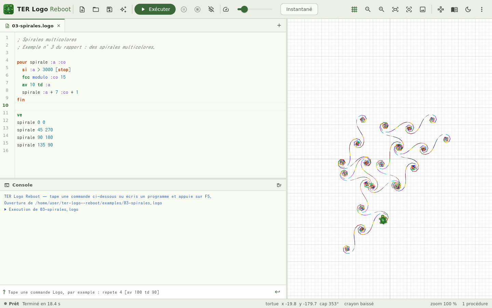
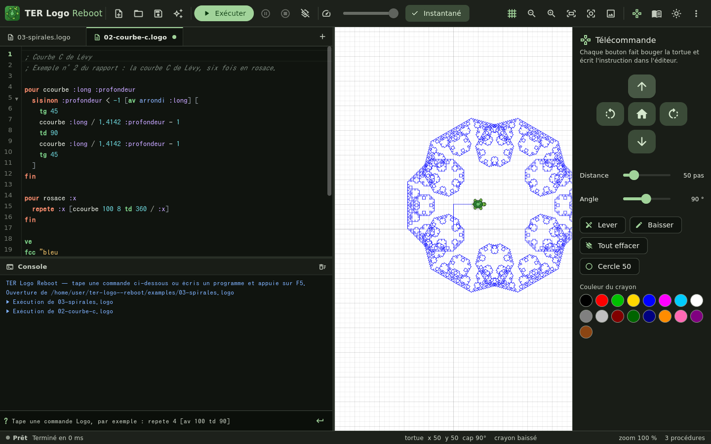

# TER Logo Reboot

Un interpréteur **Logo francophone** pour le bureau, écrit en Flutter.

C'est la réécriture, près de vingt ans plus tard, du TER « Interpréteur Logo » réalisé en
M1 Informatique à l'Université Montpellier II (2006-2007) par Simon Allier, Naïtan Grollemund,
Renaud Lalluque et Kevin Delfour, encadré par Michel Meynard. L'original était une applet
Java (JavaCC, Swing, look & feel Nimrod) ; celle-ci est un client lourd Linux livré en `.deb`
et `.rpm`.





## Ce qu'on y trouve

- **Le langage Logo, fidèle à la tradition** : `pour … fin`, entrées `:x`, mots `"bonjour`,
  listes `[a b c]`, opérateurs infixes, forme parenthésée `(somme 1 2 3)`, entrées optionnelles
  `[:y 50]`, portée dynamique, appels terminaux (une procédure peut s'appeler indéfiniment),
  et 125 primitives en français (`avance`/`av`, `repete`, `sisinon`, `retourne`, `phrase`…).
- **Un éditeur** à onglets avec coloration, numéros de ligne, recherche/remplacement
  (Ctrl+F / Ctrl+H) et la ligne fautive surlignée en cas d'erreur.
- **Une console** pour taper des commandes pas à pas, avec historique (↑/↓).
- **Une tortue animée** dont on règle la vitesse (ou dessin instantané), pause et arrêt à tout
  moment, zoom à la molette, déplacement à la souris, quadrillage de 10 pas.
- **La télécommande** du TER original : on pilote la tortue à la souris et le code Logo
  correspondant s'écrit dans l'éditeur.
- **Export** du dessin en PNG ou en SVG, thème clair ou sombre, aide intégrée (F1), exemples
  (dont ceux du rapport de 2007).

## Un avant-goût

```logo
pour carre :cote
  repete 4 [av :cote td 90]
fin

pour rosace :n
  repete :n [carre 100 td 360 / :n]
fin

ve
fcc "bleu
rosace 12
```

```logo
pour factorielle :n
  si :n < 2 [retourne 1]
  retourne :n * factorielle :n - 1
fin

ecris factorielle 10        ; 3628800
```

La liste complète des primitives est dans [docs/primitives.md](docs/primitives.md).

## Installation

Les paquets sont produits par la CI et attachés aux
[releases](https://github.com/kdelfour/TER-Logo--reboot/releases).

```sh
# Debian, Ubuntu…
sudo apt install ./ter-logo-reboot_1.0.0_amd64.deb

# Fedora, openSUSE, RHEL…
sudo dnf install ./ter-logo-reboot-1.0.0-1.x86_64.rpm
```

L'application s'installe dans `/opt/ter-logo-reboot`, avec un lanceur dans le menu
(catégorie Éducation), la commande `ter-logo-reboot` et l'association des fichiers `.logo`.

## Raccourcis

| Touche | Action |
|---|---|
| F5 | Exécuter le programme |
| Ctrl+Entrée | Exécuter la sélection |
| Échap | Arrêter |
| F6 | Pause / reprise |
| F1 | Aide sur les primitives |
| Ctrl+N / Ctrl+O / Ctrl+S | Nouveau / ouvrir / enregistrer |
| Ctrl+W | Fermer l'onglet |
| Ctrl+Maj+L | Effacer l'écran |
| Double-clic sur le dessin | Cadrer le dessin |

## Compiler depuis les sources

Il faut Flutter 3.47 et les dépendances de compilation Linux :

```sh
sudo apt install clang cmake ninja-build pkg-config libgtk-3-dev rpm patchelf
flutter pub get
flutter run -d linux             # lancer en développement
scripts/package.sh               # produire dist/*.deb et dist/*.rpm
```

L'interpréteur est un paquet Dart pur, utilisable sans interface :

```sh
cd packages/logo_core
dart test                                                    # 59 tests
dart run bin/logo.dart ../../examples/02-courbe-c.logo -o courbe.svg
```

## Architecture

```
packages/logo_core/      interpréteur, en Dart pur (aucune dépendance Flutter)
  reader.dart            texte → lignes de mots et de listes
  parser.dart            découpage en jetons et arbre syntaxique, selon l'arité des procédures
  interpreter.dart       évaluation asynchrone et coopérative, portée dynamique, appels terminaux
  primitives/            tortue, contrôle, calcul, mots et listes, entrées/sorties
  svg.dart               hôte sans interface et export SVG
lib/
  state/                 contrôleur de l'application et du canevas (file d'animation)
  ui/                    éditeur, console, canevas, télécommande, aide
packaging/linux/         .desktop, AppStream, type MIME, icônes, spec RPM
examples/                programmes d'exemple
```

Quelques choix par rapport à 2007 :

- **Plus de JavaCC** : Logo s'analyse mal avec une grammaire fixe, car le découpage d'une ligne
  dépend du nombre d'entrées de chaque procédure. Le lecteur produit des listes de mots (comme
  le vrai Logo) et l'analyseur les découpe à l'exécution, en tenant compte des arités.
- **Plus de réflexion Java** pour les bibliothèques : chaque primitive est déclarée avec ses
  synonymes, son arité et sa documentation, ce qui alimente aussi l'aide et la coloration.
- **Plus de thread d'animation** : l'interpréteur est asynchrone et rend la main
  régulièrement. Un programme qui boucle à l'infini ne bloque donc pas l'interface, et
  Stop/Pause répondent toujours. La tortue est animée par une file d'événements qui ralentit
  l'interpréteur quand elle est pleine.
- **Flame n'est pas utilisé** : un `CustomPainter` suffit. Les tracés terminés sont regroupés en
  `ui.Picture`, ce qui garde l'affichage fluide même avec des dizaines de milliers de segments.

## Licence

MIT — voir [LICENSE](LICENSE).
